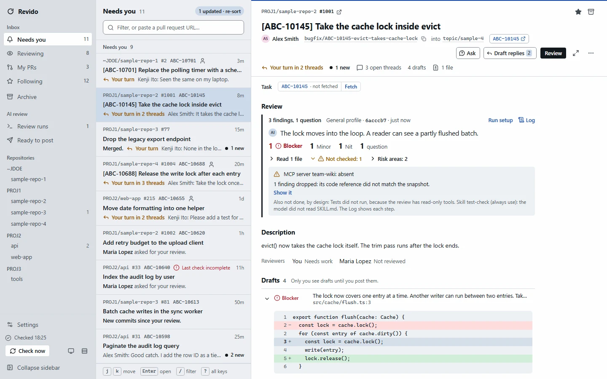
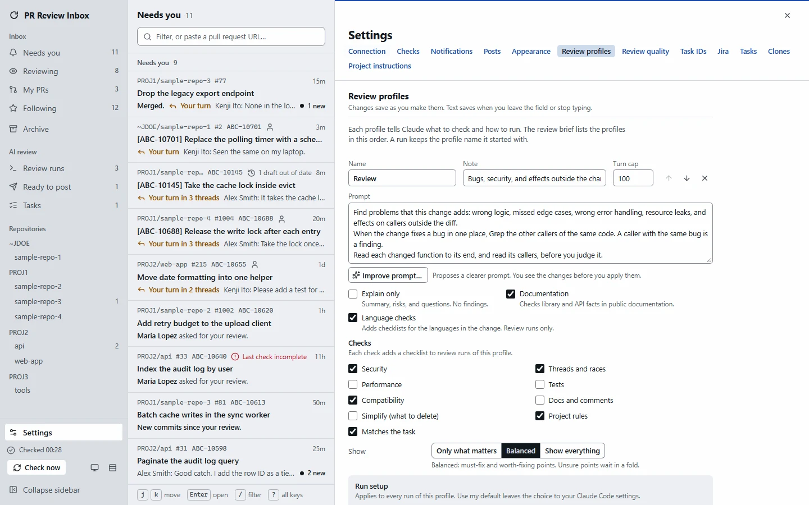
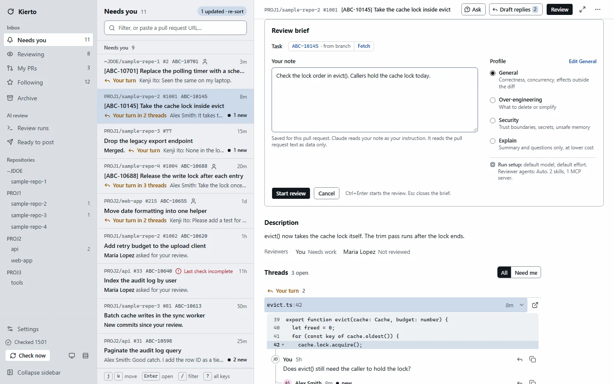
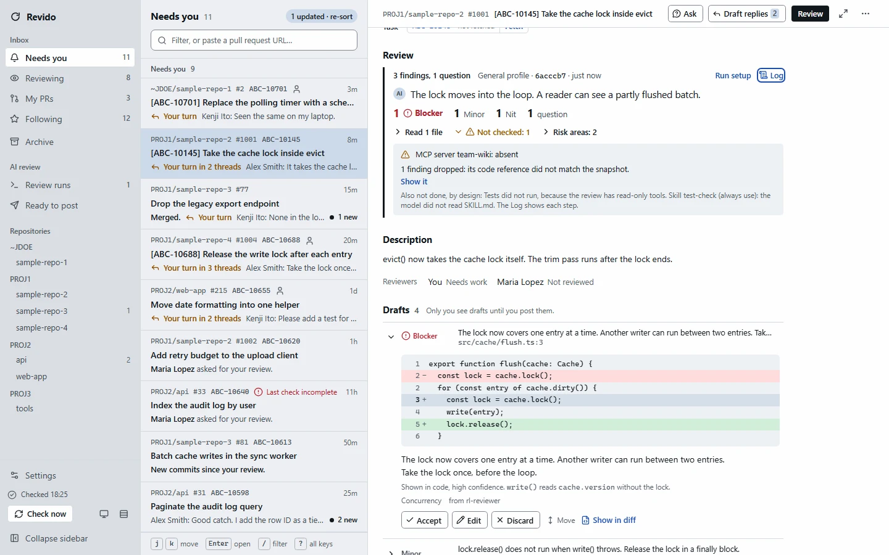
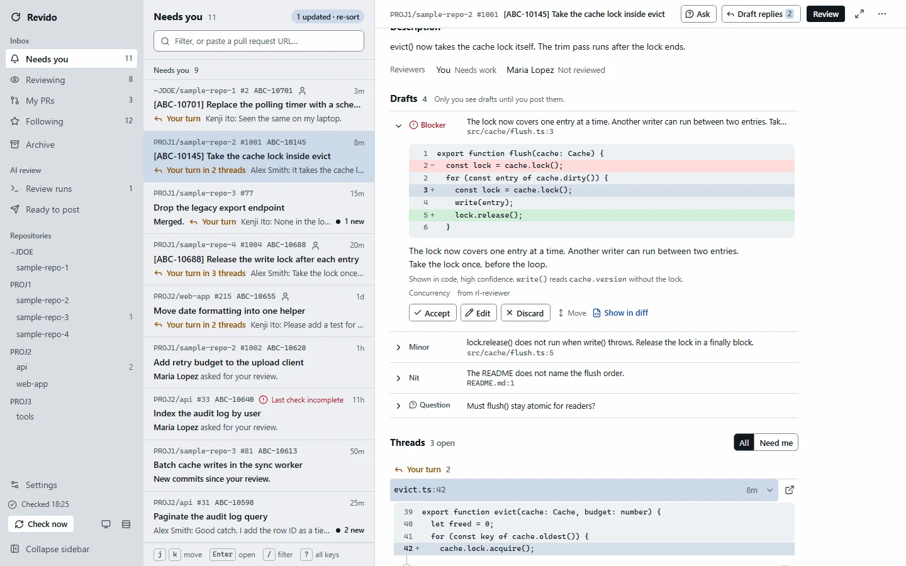
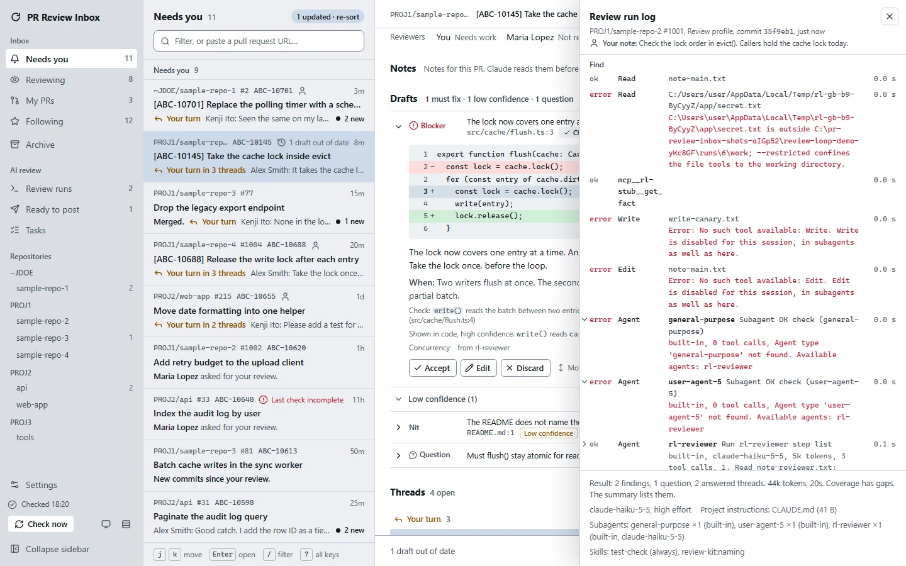
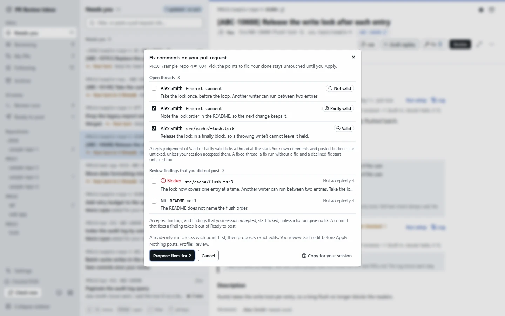
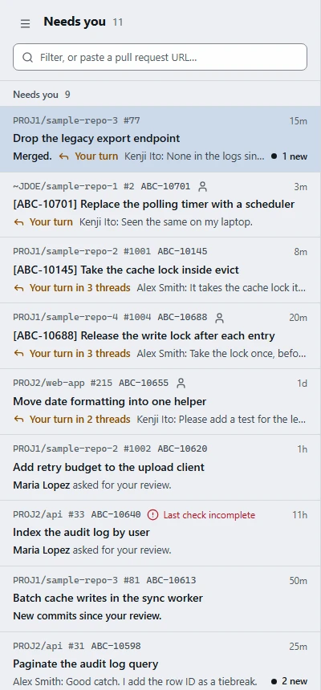

# Kierto

Local-first inbox for Bitbucket Server and Data Center pull requests, with AI code review by your own Claude Code CLI. It drafts review comments and replies, proposes fixes, and posts nothing without your click.

[](https://github.com/auric/kierto/actions/workflows/ci.yml) [](LICENSE)

Kierto helps with pull request review on Bitbucket Server and Bitbucket Data Center. It runs code review with Claude Code on your machine and can read the linked Jira issues.

Repository: https://github.com/auric/kierto

<picture>
  <source media="(prefers-color-scheme: dark)" srcset="docs/screenshots/inbox-dark.webp">
  
</picture>

## Why "Kierto"

Kierto is Finnish for "cycle" or "round". Say it roughly as "KYER-toh".

A pull request review is a loop. You review the change. The author changes the code and replies. You check again. The loop ends when every thread is resolved. Kierto keeps that loop in one place and runs each round with your own Claude Code CLI.

The project started as "Review Loop". The new name keeps the same idea in one short word.

## What it does

- Shows every open pull request that needs you in one inbox, with unread marks and a reason per row.
- Tracks each discussion per message: new comments, edits, replies, and deletions. Read state survives restarts.
- Notifies you once when someone replies to you or pushes new commits.
- Runs a Claude Code review on a sanitized snapshot of the pull request. The review reads the whole repository, not only the diff.
- Turns findings into drafts with a severity. You accept, edit, or discard each one, then post them as inline comments.
- Drafts replies to the threads where it is your turn. On your own pull request, it proposes fixes that you review before they touch your clone.
- Lists what the review did not check, so a gap never looks like a pass.

## Safety model

- Kierto runs on your machine and listens on 127.0.0.1 only. It checks the Host and Origin of each request, and each change needs a session token.
- Reviews use your own Claude Code CLI with your claude.ai login. Kierto removes `ANTHROPIC_API_KEY` and `ANTHROPIC_AUTH_TOKEN` from the child process.
- Nothing goes to Bitbucket until you click. Kierto posts your accepted drafts. Claude never posts.
- Claude never runs in your clone. Reviews run on a sanitized snapshot with read-only tools. Kierto never pushes.
- Your Bitbucket token goes into the OS secret store. It never goes into the database, logs, URLs, or prompts.

## Requirements

- Windows or Linux.
- The `claude` CLI, logged in with a claude.ai subscription. Check with `claude auth status`.
- A Bitbucket Server or Data Center personal access token.
- `git` on the PATH.
- Bun 1.x, only to build from source.

## Install

No release is published yet. Build Kierto from source with Bun 1.x:

```sh
bun install
bun run build
bun run start
```

For one self-contained binary, run `bun run compile`. It writes `dist/bin/kierto-<os>-<arch>` for this host.

Release binaries: when a release is published on the GitHub Releases page, download the binary for your system and start it. Each release holds one binary per target, `SHA256SUMS`, and the license files. `bun run release` makes them.

```sh
./kierto-0.2.0-linux-x64          # Linux: chmod +x it first
kierto-0.2.0-windows-x64.exe      # Windows
```

## First run

1. Open http://127.0.0.1:7317.
2. Enter your Bitbucket URL and access token, then click Save. Kierto tests the connection first.
3. Optional: in Settings, Jira, connect Jira. The review brief can then fetch the task text.
4. The inbox lists the pull requests on your Bitbucket dashboard. To follow another one, paste its URL into the filter.
5. Open a pull request and press `r` to open the review brief. Add a note and pick a profile.
6. Click Start review, or press `Ctrl+Enter`.
7. Triage each draft: `a` accepts, `e` edits, `d` discards.
8. Press `p` to post the accepted drafts. Kierto shows a confirm first.

## Features

### Review profiles

A profile sets the prompt, the model, the effort, the reviewer agents, the skills, and the MCP servers of a run. Kierto ships General, Over-engineering, Security, and Explain. Skills and MCP servers come from your Claude Code config. "Improve prompt" proposes a clearer prompt, and you see the changes before you apply them.



The review brief holds the task, your note, the profile, and the run setup. A review starts only from the brief.



### Drafts and posting

Each finding becomes a draft with its code, its severity, and its evidence. The review record counts the drafts per severity and lists what was not checked. Only you see drafts until you post them.





The run log shows each tool call of the review and of its subagents.



### Replies

Draft replies judges each thread where it is your turn: valid, partly valid, not valid, or a question. It drafts a reply for each one. You edit the reply and post it.

### Fix it

On your own pull request, the Fix list holds the open threads and the review findings. Valid threads and accepted findings start ticked. A read-only run checks each ticked point and proposes exact edits. You review each edit. Apply commits the edits into your clone. You push.



### Ask

Press `q` to ask a question about the pull request. The answer stays in Kierto. Nothing posts.

### Project instructions

Each run can read the CLAUDE.md files of your clone, extra text from Settings, and your global CLAUDE.md. CLAUDE.md files in the pull request do not load as instructions. Settings shows the full text that a run gets.

### Consult your session

You wrote the code with Claude Code, so your session knows why. Turn on the session switch in Settings, Clones. Kierto then lists your sessions on the branch of your own pull request. Each question resumes a copy of the session with the review points. Its verdicts tick the Fix list and draft replies. "Copy for your session" gives the same points as text. On your own pull request, "Judge and propose fixes" lets the forked, read-only session judge each item and propose edits for the ones it accepts. Kierto checks the edits, and their fix cards show "from your session". Nothing applies until you click.

### Narrow screens

Below 760 px, Kierto shows one pane at a time.



## Keyboard

Press `?` in the app for the full list.

| Keys | Action |
|---|---|
| `j` `k` | Next or previous pull request, draft, thread, or file |
| `Enter` `→` | Open the pull request at the thread that put it in the inbox |
| `Esc` `←` | Back to the list |
| `/` | Filter the list |
| `z` | Full width on or off |
| `n` `N` | Next or previous new message |
| `y` | Next thread where it is your turn |
| `o` | Open or close the current draft, thread, or file |
| `g` then `f` or `c` | Go to Files or Commits |
| `g` then `d` | Show the current thread or draft in the diff |
| `1` `2` `3` | Top of the pull request, the drafts, the run log |
| `r` | Open the review brief |
| `c` | Review only the commits since the last review |
| `q` | Ask a question |
| `Ctrl+Enter` | Start the review from the brief, or send the question |
| `a` `e` `d` | Accept, edit, or discard the current draft |
| `p` | Post the accepted items |
| `f` `F` | Your pull request: open the Fix list |

## Configuration

The environment variables keep the `REVIEW_LOOP_` prefix of the old name, so existing data keeps working.

| Variable | Effect |
|---|---|
| `REVIEW_LOOP_PORT` | The port on 127.0.0.1. Default: 7317. |
| `REVIEW_LOOP_DATA_DIR` | The data folder. Default: `%LOCALAPPDATA%\review-loop` on Windows, `$XDG_DATA_HOME/review-loop` or `~/.local/share/review-loop` on Linux. |
| `REVIEW_LOOP_SECRETS` | `memory` keeps the tokens out of the OS secret store. You then enter them again after each restart. |

If the OS secret store fails, Kierto keeps the token in memory only and tells you in Settings.

## Development

| Command | Effect |
|---|---|
| `bun run dev` | Hono with `--watch` on 127.0.0.1:7317 and Vite on 127.0.0.1:5173. Open the Vite URL. |
| `bun run check` | Typecheck with TypeScript 7 and 5, Biome lint, and `bun test`. |
| `bun run test:e2e` | Build the UI and run the Playwright suite against a fake Bitbucket and a fake Jira. |
| `bun run demo` | Serve the built UI on 127.0.0.1:7399 with synthetic data, a fake CLI, and a temp data folder. |
| `bun run compile` | Build one self-contained binary for this host in `dist/bin/kierto-<os>-<arch>`. |
| `bun run release` | Run check, e2e, and compile for all targets. Write the binaries, `SHA256SUMS`, and the license files to `dist/release/`. |
| `bun run notices` | Regenerate `THIRD_PARTY_NOTICES.md` from the web bundle and the server bundle. |
| `bun run screenshots` | Regenerate the screenshots in `docs/screenshots/` from the demo. |

Tests never touch a real Bitbucket server, the real `claude` CLI, or your data folder. `BRIEF.md` is the spec. `docs/` holds the plans and the manual smoke tests.

## License

Kierto is free software under the GNU Affero General Public License v3.0 or later (`AGPL-3.0-or-later`). See [LICENSE](LICENSE). [NOTICE.md](NOTICE.md) states the copyright and the section 7 additional terms. These terms require attribution and marked, renamed modified versions. They grant no trademark rights to the name "Kierto". Third-party material keeps its own license. [THIRD_PARTY_NOTICES.md](THIRD_PARTY_NOTICES.md) lists it.
